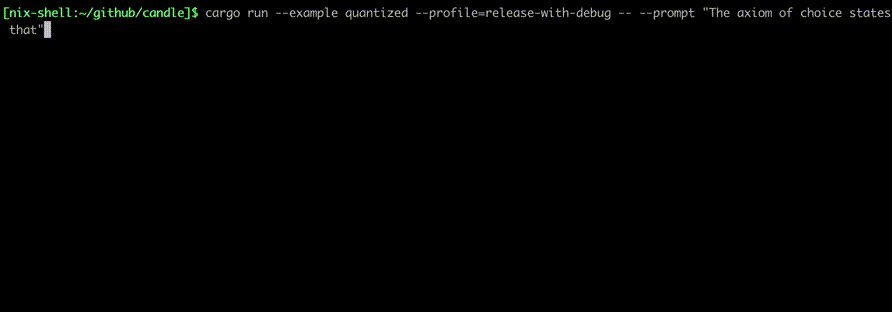
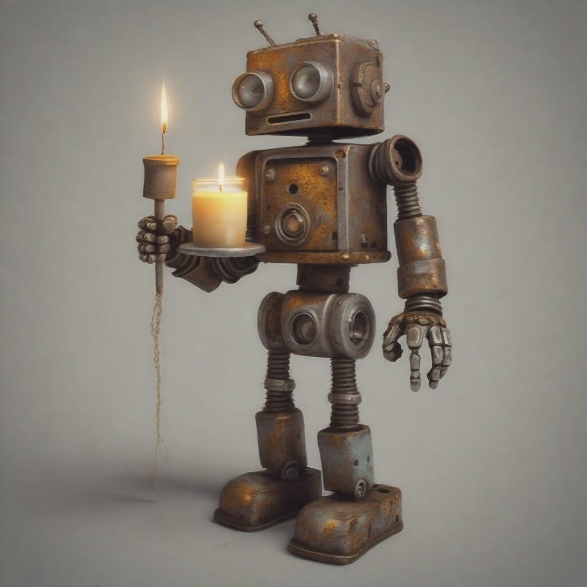
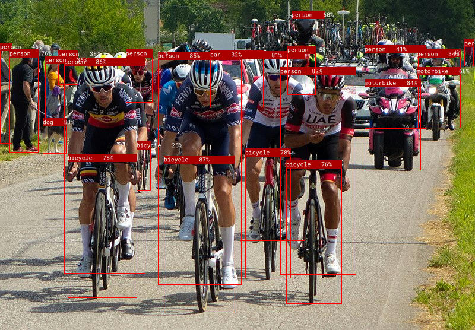
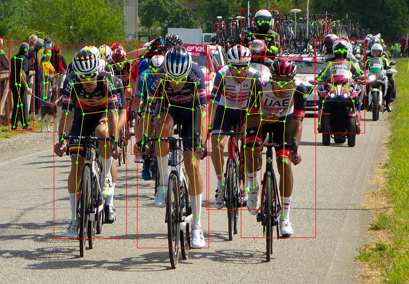

# candle
[](https://discord.gg/hugging-face-879548962464493619)
[](https://crates.io/crates/candle-core)
[](https://docs.rs/candle-core)
[](https://github.com/huggingface/candle/blob/main/LICENSE-MIT)
[](https://github.com/huggingface/candle/blob/main/LICENSE-APACHE)

[ [English](README.md) | 简体中文 ]

Candle 是一个专为 Rust 打造的极简主义机器学习（ML）框架，专注于卓越性能（包括 GPU 支持）与易用性。欢迎体验在线 Demo：
[whisper](https://huggingface.co/spaces/lmz/candle-whisper)、
[LLaMA2](https://huggingface.co/spaces/lmz/candle-llama2)、
[T5](https://huggingface.co/spaces/radames/Candle-T5-Generation-Wasm)、
[yolo](https://huggingface.co/spaces/lmz/candle-yolo)、
[Segment Anything](https://huggingface.co/spaces/radames/candle-segment-anything-wasm)。

## 快速开始

请按照 [**安装指南 (Installation)**](https://huggingface.github.io/candle/guide/installation.html) 中的说明正确安装 [`candle-core`](https://github.com/huggingface/candle/tree/main/candle-core)。

下面演示如何运行简单的矩阵乘法。请将以下代码写入 `myapp/src/main.rs` 文件：
```rust
use candle_core::{Device, Tensor};

fn main() -> Result<(), Box<dyn std::error::Error>> {
    let device = Device::Cpu;

    let a = Tensor::randn(0f32, 1., (2, 3), &device)?;
    let b = Tensor::randn(0f32, 1., (3, 4), &device)?;

    let c = a.matmul(&b)?;
    println!("{c}");
    Ok(())
}
```

运行 `cargo run` 将输出形状为 `Tensor[[2, 4], f32]` 的张量。

在安装了支持 CUDA 的 `candle` 后，只需将 `device` 设置为 GPU 即可：

```diff
- let device = Device::Cpu;
+ let device = Device::new_cuda(0)?;
```

如需查看更高级的示例，请参阅下一章节。

## 示例展示

以下是在线 Demo，完全在您的浏览器端运行：
- [yolo](https://huggingface.co/spaces/lmz/candle-yolo)：姿态估计与目标识别。
- [whisper](https://huggingface.co/spaces/lmz/candle-whisper)：语音识别。
- [LLaMA2](https://huggingface.co/spaces/lmz/candle-llama2)：文本生成。
- [T5](https://huggingface.co/spaces/radames/Candle-T5-Generation-Wasm)：文本生成。
- [Phi-1.5, and Phi-2](https://huggingface.co/spaces/radames/Candle-Phi-1.5-Wasm)：文本生成。
- [Segment Anything Model](https://huggingface.co/spaces/radames/candle-segment-anything-wasm)：图像分割。
- [BLIP](https://huggingface.co/spaces/radames/Candle-BLIP-Image-Captioning)：图像描述生成。

我们还提供了一些基于前沿模型的命令行示例：

- [LLaMA v1, v2, and v3](./candle-examples/examples/llama/)：通用大语言模型，包含 SOLAR-10.7B 变体。
- [Falcon](./candle-examples/examples/falcon/)：通用大语言模型。
- [Codegeex4](./candle-examples/examples/codegeex4-9b/)：代码补全、代码解释器、联网搜索、函数调用与仓库级任务。
- [GLM4](./candle-examples/examples/glm4/)：清华智谱 THUDM 开源多语言多模态对话模型。
- [Gemma v1 and v2](./candle-examples/examples/gemma/)：来自 Google DeepMind 的 2B 与 7B+/9B 通用大语言模型。
- [RecurrentGemma](./candle-examples/examples/recurrent-gemma/)：来自 Google 的 2B 与 7B Griffin 架构模型，融合了注意力机制与类似 RNN 的循环状态。
- [Phi-1, Phi-1.5, Phi-2, and Phi-3](./candle-examples/examples/phi/)：1.3B、2.7B 和 3.8B 通用大语言模型，性能媲美 7B 模型。
- [StableLM-3B-4E1T](./candle-examples/examples/stable-lm/)：在 1T tokens 英文和代码数据集上预训练的 3B 通用大语言模型。亦支持在 2T tokens 上训练的 StableLM-2 1.6B 及其代码变体。
- [Mamba](./candle-examples/examples/mamba/)：Mamba 状态空间模型（SSM）的纯推理实现。
- [Mistral7b-v0.1](./candle-examples/examples/mistral/)：7B 通用大模型，性能超越截止 2023-09-28 公开发布的所有 13B 模型。
- [Mixtral8x7b-v0.1](./candle-examples/examples/mixtral/)：稀疏混合专家（MoE）8x7B 通用模型，推理速度更快且性能超越 Llama 2 70B。
- [StarCoder](./candle-examples/examples/bigcode/) 与 [StarCoder2](./candle-examples/examples/starcoder2/)：专注于代码生成的大语言模型。
- [Qwen1.5](./candle-examples/examples/qwen/)：中英双语大语言模型。
- [RWKV v5 and v6](./candle-examples/examples/rwkv/)：具备 Transformer 级别性能的 RNN 架构模型。
- [Replit-code-v1.5](./candle-examples/examples/replit-code/)：专为代码补全设计的 3.3B 模型。
- [Yi-6B / Yi-34B](./candle-examples/examples/yi/)：零一万物推出的 6B 与 34B 中英双语通用大语言模型。
- [Quantized LLaMA](./candle-examples/examples/quantized/)：使用与 [llama.cpp](https://github.com/ggerganov/llama.cpp) 相同量化技术的 LLaMA 量化版本。
- [Quantized Qwen3 MoE](./candle-examples/examples/quantized-qwen3-moe/)：支持 Qwen3 MoE 模型的 GGUF 量化版本。



- [Stable Diffusion](./candle-examples/examples/stable-diffusion/)：文生图模型，支持 1.5、2.1、SDXL 1.0 和 Turbo 版本。



- [Wuerstchen](./candle-examples/examples/wuerstchen/)：另一种文生图生成模型。


- [yolo-v3](./candle-examples/examples/yolo-v3/) 与 [yolo-v8](./candle-examples/examples/yolo-v8/)：目标检测与姿态估计模型。


- [segment-anything](./candle-examples/examples/segment-anything/)：带有提示（Prompt）引导的图像分割模型。


- [SegFormer](./candle-examples/examples/segformer/)：基于 Transformer 的语义分割模型。
- [Whisper](./candle-examples/examples/whisper/)：语音识别模型。
- [EnCodec](./candle-examples/examples/encodec/)：基于残差向量量化的高保真音频压缩模型。
- [MetaVoice](./candle-examples/examples/metavoice/)：语音生成（TTS）基座模型。
- [Parler-TTS](./candle-examples/examples/parler-tts/)：大规模文本转语音模型。
- [T5](./candle-examples/examples/t5)、[Bert](./candle-examples/examples/bert/)、[JinaBert](./candle-examples/examples/jina-bert/)：用于计算句子嵌入向量（Sentence Embeddings）。
- [DINOv2](./candle-examples/examples/dinov2/)：自监督计算机视觉模型（可用于 ImageNet 分类、深度估计与图像分割）。
- [VGG](./candle-examples/examples/vgg/)、[RepVGG](./candle-examples/examples/repvgg)：经典计算机视觉模型。
- [BLIP](./candle-examples/examples/blip/)：图生文多模态模型，可用于图像生成 Caption。
- [CLIP](./candle-examples/examples/clip/)：图文跨模态模型。
- [TrOCR](./candle-examples/examples/trocr/)：Transformer OCR 字符识别模型，提供针对手写体与印刷体的专用子模型。
- [Marian-MT](./candle-examples/examples/marian-mt/)：神经机器翻译模型，根据输入文本生成翻译结果。
- [Moondream](./candle-examples/examples/moondream/)：可针对图像回答现实世界问题的轻量级多模态视觉模型。

可以使用类似如下的命令运行示例：
```
cargo run --example quantized --release
```

为了使用 **CUDA**，请在示例命令行中添加 `--features cuda`。如果您安装了 cuDNN，使用 `--features cudnn` 可获得更显著的速度提升。可选的 `cutile` 特性支持在 Rust 中编写 JIT 编译的 CUDA 内核；配置与互操作详情请参阅 [cuTile 指南](./candle-book/src/guide/cutile.md)。

此外，还提供了一些针对 whisper 和 [llama2.c](https://github.com/karpathy/llama2.c) 的 WASM 示例。您可以使用 `trunk` 本地构建，或直接在线体验：
[whisper](https://huggingface.co/spaces/lmz/candle-whisper)、
[llama2](https://huggingface.co/spaces/lmz/candle-llama2)、
[T5](https://huggingface.co/spaces/radames/Candle-T5-Generation-Wasm)、
[Phi-1.5, and Phi-2](https://huggingface.co/spaces/radames/Candle-Phi-1.5-Wasm)、
[Segment Anything Model](https://huggingface.co/spaces/radames/candle-segment-anything-wasm)。

对于 LLaMA2，可运行以下命令获取权重文件并启动本地测试服务器：
```bash
# 安装目标平台 'wasm32-unknown-unknown'
rustup target add wasm32-unknown-unknown

cd candle-wasm-examples/llama2-c
wget https://huggingface.co/spaces/lmz/candle-llama2/resolve/main/model.bin
wget https://huggingface.co/spaces/lmz/candle-llama2/resolve/main/tokenizer.json
trunk serve --release --port 8081
```
然后在浏览器中访问 [http://localhost:8081/](http://localhost:8081/)。

<!--- ANCHOR: useful_libraries --->

## 实用的外部资源
- [`candle-tutorial`](https://github.com/ToluClassics/candle-tutorial)：非常详尽的教程，演示如何将 PyTorch 模型迁移至 Candle。
- [`candle-lora`](https://github.com/EricLBuehler/candle-lora)：专为 Candle 设计的高效且符合人体工学的 LoRA 实现，开箱即用支持多种模型（参见[示例](https://github.com/EricLBuehler/candle-lora/tree/master/candle-lora-transformers/examples)）。
- [`candle-video`](https://github.com/FerrisMind/candle-video)：基于 Candle 构建的文本生成视频 Rust 库（支持 LTX-Video 等模型），专注于快速、免 Python 的本地推理。
- [`optimisers`](https://github.com/KGrewal1/optimisers)：优化器集合，包括带动量的 SGD、AdaGrad、AdaDelta、AdaMax、NAdam、RAdam 和 RMSprop。
- [`candle-vllm`](https://github.com/EricLBuehler/candle-vllm)：高效的本地 LLM 推理与服务平台，内置兼容 OpenAI 的 API 服务器。
- [`candle-ext`](https://github.com/mokeyish/candle-ext)：Candle 扩展库，提供当前 Candle 尚未原生支持的 PyTorch 常用函数。
- [`candle-coursera-ml`](https://github.com/vishpat/candle-coursera-ml)：Coursera [机器学习专项课程](https://www.coursera.org/specializations/machine-learning-introduction)算法的 Rust 实现。
- [`kalosm`](https://github.com/floneum/floneum/tree/master/interfaces/kalosm)：用于对接本地预训练模型的 Rust 多模态元框架，支持受控生成、自定义采样器、内存向量数据库、音频转录等。
- [`candle-sampling`](https://github.com/EricLBuehler/candle-sampling)：针对 Candle 的各类采样技术实现。
- [`gpt-from-scratch-rs`](https://github.com/jeroenvlek/gpt-from-scratch-rs)：将 Andrej Karpathy 的《从零构建 GPT》移植为 Rust 并在玩具问题上展示 Candle API。
- [`candle-einops`](https://github.com/tomsanbear/candle-einops)：Python [einops](https://github.com/arogozhnikov/einops) 库的纯 Rust 实现。
- [`atoma-infer`](https://github.com/atoma-network/atoma-infer)：用于大规模快速推理的 Rust 库，利用 FlashAttention2 进行高效注意力计算，利用 PagedAttention 进行高效 KV-cache 内存管理，支持多 GPU 并兼容 OpenAI API。
- [`llms-from-scratch-rs`](https://github.com/nerdai/llms-from-scratch-rs)：Sebastian Raschka《从零构建大语言模型》一书代码的全面 Rust 实现。
- [`vllm.rs`](https://github.com/guoqingbao/vllm.rs)：基于 Candle 的极简主义 Rust 版 vLLM 实现。

如果您有想补充到此列表的项目，欢迎提交 Pull Request。

<!--- ANCHOR_END: useful_libraries --->

<!--- ANCHOR: features --->

## 功能特性

- 语法简洁，体验贴近 PyTorch：
    - 支持模型训练。
    - 支持嵌入用户自定义算子/内核，例如 [flash-attention v2](https://github.com/huggingface/candle/blob/89ba005962495f2bfbda286e185e9c3c7f5300a3/candle-flash-attn/src/lib.rs#L152)。
- 后端支持：
    - 经过高度优化的 CPU 后端，x86 架构可选支持 MKL，Mac 支持 Accelerate。
    - CUDA 后端，支持在 GPU 上高效运行，并可通过 NCCL 实现多 GPU 分布式。
    - WASM 支持，可在浏览器中运行模型。
- 内置支持的模型：
    - 大语言模型 (LLMs)：
        - LLaMA v1、v2、v3 以及 SOLAR-10.7B 等变体。
        - Falcon。
        - StarCoder、StarCoder2。
        - Phi 1、1.5、2 与 3。
        - Mamba、Minimal Mamba。
        - Gemma v1 (2B/7B+)、v2 (2B/9B)。
        - Mistral 7b v0.1。
        - Mixtral 8x7b v0.1。
        - StableLM-3B-4E1T、StableLM-2-1.6B、Stable-Code-3B。
        - Replit-code-v1.5-3B。
        - Bert。
        - Yi-6B 与 Yi-34B。
        - Qwen1.5、Qwen1.5 MoE、Qwen3 MoE。
        - RWKV v5 与 v6。
    - 量化大模型：
        - Llama 7B、13B、70B 及其 chat 和 code 变体。
        - Mistral 7B 与 7B Instruct。
        - Mixtral 8x7B。
        - Zephyr 7B a 与 b（基于 Mistral-7B）。
        - OpenChat 3.5（基于 Mistral-7B）。
        - Qwen3 MoE (16B-A3B, 32B-A3B)。
    - 文本到文本 (Text to text)：
        - T5 及其变体：FlanT5、UL2、MADLAD400（翻译）、CoEdit（语法纠错）。
        - Marian MT（机器翻译）。
    - 文本到图像 (Text to image)：
        - Stable Diffusion v1.5、v2.1、XL v1.0。
        - Wurstchen v2。
    - 图像到文本 (Image to text)：
        - BLIP。
        - TrOCR。
    - 音频 (Audio)：
        - Whisper，多语言语音转文本。
        - EnCodec，音频压缩模型。
        - MetaVoice-1B，文本转语音模型。
        - Parler-TTS，文本转语音模型。
    - 计算机视觉模型 (Computer Vision Models)：
        - DINOv2、ConvMixer、EfficientNet、ResNet、ViT、VGG、RepVGG、ConvNeXT、ConvNeXTv2、MobileOne、EfficientVit (MSRA)、MobileNetv4、Hiera、FastViT。
        - yolo-v3、yolo-v8。
        - Segment-Anything Model (SAM)。
        - SegFormer。
- 文件格式支持：可直接从 safetensors、npz、ggml 或 PyTorch 格式加载模型。
- Serverless（基于 CPU）：体积轻巧、冷启动快速的高效部署。
- 量化支持：支持 llama.cpp 量化类型。

<!--- ANCHOR_END: features --->

## 使用指南

<!--- ANCHOR: cheatsheet --->
速查表 (Cheatsheet)：

| 操作分类 | 使用 PyTorch | 使用 Candle |
|---|---|---|
| 创建张量 | `torch.Tensor([[1, 2], [3, 4]])` | `Tensor::new(&[[1f32, 2.], [3., 4.]], &Device::Cpu)?` |
| 创建零张量 | `torch.zeros((2, 2))` | `Tensor::zeros((2, 2), DType::F32, &Device::Cpu)?` |
| 索引切片 | `tensor[:, :4]` | `tensor.i((.., ..4))?` |
| 改变形状 | `tensor.view((2, 2))` | `tensor.reshape((2, 2))?` |
| 矩阵乘法 | `a.matmul(b)` | `a.matmul(&b)?` |
| 算术运算 | `a + b` | `&a + &b` |
| 转移设备 | `tensor.to(device="cuda")` | `tensor.to_device(&Device::new_cuda(0)?)?` |
| 转换类型 | `tensor.to(dtype=torch.float16)` | `tensor.to_dtype(&DType::F16)?` |
| 权重保存 | `torch.save({"A": A}, "model.bin")` | `candle::safetensors::save(&HashMap::from([("A", A)]), "model.safetensors")?` |
| 权重加载 | `weights = torch.load("model.bin")` | `candle::safetensors::load("model.safetensors", &device)` |

<!--- ANCHOR_END: cheatsheet --->

## 目录结构

- [candle-core](./candle-core)：核心算子、设备抽象与 `Tensor` 结构体定义
- [candle-nn](./candle-nn/)：构建真实模型的常用工具与组件
- [candle-examples](./candle-examples/)：在实际场景下使用该库的丰富示例
- [candle-kernels](./candle-kernels/)：CUDA 自定义内核
- [candle-datasets](./candle-datasets/)：数据集与数据加载器
- [candle-transformers](./candle-transformers)：Transformer 相关的实用工具
- [candle-flash-attn](./candle-flash-attn)：Flash Attention v2 算子层
- [candle-onnx](./candle-onnx/)：ONNX 模型评估支持

## 常见问题 (FAQ)

### 为什么选择 Candle？

<!--- ANCHOR: goals --->

Candle 的核心目标是**让 Serverless 推理成为可能**。像 PyTorch 这样的全功能机器学习框架体积极其庞大，在集群上创建或迁移实例耗时较长。Candle 允许构建并部署体积小巧的轻量级独立二进制文件。

其次，Candle 帮助您**在生产环境中摆脱对 Python 的依赖**。Python 的运行时开销会严重影响性能，且 [GIL 全局解释器锁](https://www.backblaze.com/blog/the-python-gil-past-present-and-future/)也是业界著名的性能瓶颈。

最后，Rust 非常优秀！Hugging Face 生态系统中许多核心库均已由 Rust 编写，如 [safetensors](https://github.com/huggingface/safetensors) 和 [tokenizers](https://github.com/huggingface/tokenizers)。

<!--- ANCHOR_END: goals --->

### 其他机器学习框架对比

- [dfdx](https://github.com/coreylowman/dfdx)：这是一个非常强大的 Rust crate，张量形状被编码在类型系统中，能让编译器在编译期捕获形状不匹配错误。但部分特性仍依赖 nightly 版本，对于非 Rust 专家来说编写门槛相对较高。我们正在运行时层面贡献并借助其他核心 crate，希望两者能相互促进。
- [burn](https://github.com/burn-rs/burn)：通用深度学习 crate，支持多种后端，可根据工作负载选择最佳运行引擎。
- [tch-rs](https://github.com/LaurentMazare/tch-rs.git)：Rust 对 C++ LibTorch 的绑定库。功能极其全面，但会将整个 Torch 库引入运行时。`tch-rs` 的主要维护者同时也深度参与了 `candle` 的开发。

### 常见错误排查

#### 使用 mkl 特性编译时缺失符号

当使用 `mkl` 或 `accelerate` 特性编译二进制或测试时，若遇到缺失符号错误，例如 mkl 报错：
```
  = note: /usr/bin/ld: (....o): in function `blas::sgemm':
          .../blas-0.22.0/src/lib.rs:1944: undefined reference to `sgemm_' collect2: error: ld returned 1 exit status

  = note: some `extern` functions couldn't be found; some native libraries may need to be installed or have their path specified
  = note: use the `-l` flag to specify native libraries to link
  = note: use the `cargo:rustc-link-lib` directive to specify the native libraries to link with Cargo
```
或 accelerate 报错：
```
Undefined symbols for architecture arm64:
            "_dgemm_", referenced from:
                candle_core::accelerate::dgemm::h1b71a038552bcabe in libcandle_core...
            "_sgemm_", referenced from:
                candle_core::accelerate::sgemm::h2cf21c592cba3c47 in libcandle_core...
          ld: symbol(s) not found for architecture arm64
```

这通常是由于缺少启用 MKL 库所需的链接器标志所致。对于 MKL，可尝试在二进制入口文件顶部添加：
```rust
extern crate intel_mkl_src;
```
对于 Accelerate，添加：
```rust
extern crate accelerate_src;
```

#### 运行 LLaMA 示例提示需要凭证 (401)

```
Error: request error: https://huggingface.co/meta-llama/Llama-2-7b-hf/resolve/main/tokenizer.json: status code 401
```

这通常是因为您尚未获得 LLaMA-v2 模型的访问权限。请前往 Hugging Face Hub 注册账号，同意 [LLaMA-v2 模型使用协议](https://huggingface.co/meta-llama/Llama-2-7b-hf)，并配置认证 Token。详见 Issue [#350](https://github.com/huggingface/candle/issues/350)。

#### Docker 构建

在 Dockerfile 中编译 CUDA 内核时，无法使用 `nvidia-smi` 自动检测算力架构（Compute Capability）。

必须显式设置 `CUDA_COMPUTE_CAP`，示例：

```dockerfile
FROM nvidia/cuda:12.9.0-devel-ubuntu22.04

# 安装 git 与 curl
RUN set -eux; \
  apt-get update; \
  apt-get install -y curl git ca-certificates;

# 安装 Rust
RUN curl --proto '=https' --tlsv1.2 -sSf https://sh.rustup.rs | sh -s -- -y

# 克隆 candle 仓库
RUN git clone https://github.com/huggingface/candle.git

# 为构建设置算力架构
ARG CUDA_COMPUTE_CAP=90
ENV CUDA_COMPUTE_CAP=${CUDA_COMPUTE_CAP}

# 使用显式算力进行构建
WORKDIR /app
COPY . .
RUN cargo build --release features cuda
```

#### 使用 flash-attention 编译失败

```
/usr/include/c++/11/bits/std_function.h:530:146: error: parameter packs not expanded with ‘...’:
```

这是 CUDA 编译器触发的 gcc-11 缺陷。解决方法是安装其他受支持的 GCC 版本（例如 gcc-10），并通过 `NVCC_CCBIN` 环境变量指定编译器路径：
```bash
env NVCC_CCBIN=/usr/lib/gcc/x86_64-linux-gnu/10 cargo ...
```

#### Windows 上运行 rustdoc 或 mdbook 测试出现链接错误

```
Couldn't compile the test.
---- .\candle-book\src\inference\hub.md - Using_the_hub::Using_in_a_real_model_ (line 50) stdout ----
error: linking with `link.exe` failed: exit code: 1181
//very long chain of linking
 = note: LINK : fatal error LNK1181: cannot open input file 'windows.0.48.5.lib'
```

请确保链接了项目目标目录之外可能存在的所有本地库，例如运行 mdbook 测试时：

```powershell
mdbook test candle-book -L .\target\debug\deps\ `
-L native=$env:USERPROFILE\.cargo\registry\src\index.crates.io-6f17d22bba15001f\windows_x86_64_msvc-0.42.2\lib `
-L native=$env:USERPROFILE\.cargo\registry\src\index.crates.io-6f17d22bba15001f\windows_x86_64_msvc-0.48.5\lib
```

#### WSL 环境下模型加载速度极慢

这通常是因为模型存放在 `/mnt/c` 跨文件系统挂载路径所致，详见 [StackOverflow 说明](https://stackoverflow.com/questions/68972448/why-is-wsl-extremely-slow-when-compared-with-native-windows-npm-yarn-processing)。

#### 追踪运行时错误

设置环境变量 `RUST_BACKTRACE=1` 可在 Candle 发生错误时打印完整的回溯调用栈信息。

#### CudaRC 错误

如果在 Windows 上遇到类似 `called Result::unwrap() on an Err value: LoadLibraryExW { source: Os { code: 126, kind: Uncategorized, message: "The specified module could not be found." } }` 的错误，请复制并重命名以下 3 个文件（确保其处于系统 PATH 路径中，具体路径取决于您的 CUDA 版本）：
`c:\Windows\System32\nvcuda.dll` -> `cuda.dll`
`c:\Program Files\NVIDIA GPU Computing Toolkit\CUDA\v12.4\bin\cublas64_12.dll` -> `cublas.dll`
`c:\Program Files\NVIDIA GPU Computing Toolkit\CUDA\v12.4\bin\curand64_10.dll` -> `curand.dll`

---

> **免责声明**：本文档由社区志愿者维护与翻译。如翻译内容与英文原文存在出入，请以英文原版为准。
